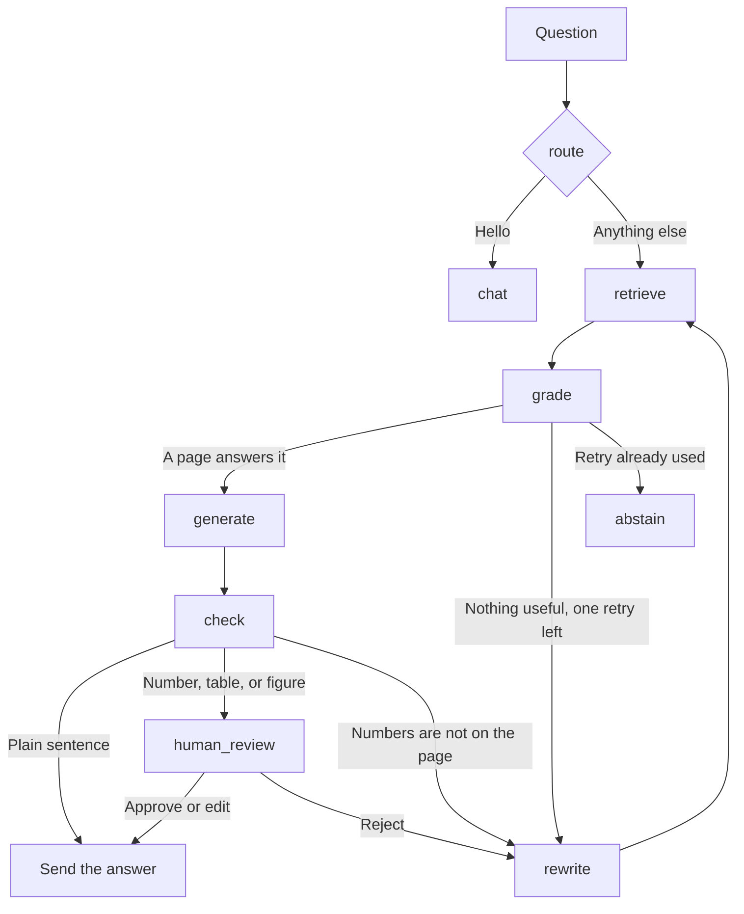

# 01 — Document desk

Meera's paper drawer. The customer asks about a figure or a table. The app searches this packet of real documents, shows the page, and waits when the draft contains a measured number.

The screen title is **Ledgerline document desk**.

## Run it

From this folder, with the course Python environment active:

```bash
python -m pip install -r requirements.txt
python download_corpus.py
python document_rag.py build
python -m streamlit run app.py
```

`download_corpus.py` copies seven short finance PDFs and one Word file into `corpus/`. Those files are not in git.

`document_rag.py build` turns the files into searchable chunks. The first build calls the vision model on a few chart pages, so it can take several minutes. Later runs reuse `chroma_db/`. That folder is not in git either.

Ollama must already be running, with `qwen3.5:4b` and `qwen3-embedding:4b`. If the sidebar says Ollama is not running, start Ollama and refresh the page.

Open **Path** under each answer. That list is the code path for the click you just made.

If a draft is waiting for a signature, the buttons go quiet. Finish the signature before you ask something else.

## Click these, in order

| Button | What you are checking |
|---|---|
| Greeting | The packet stays closed. |
| Not in the packet | HarborDesk leave is not in these files. The desk says `NOT_IN_CORPUS`. A nearby page is not an answer. |
| Walker Ranch figure | The answer is on a figure. The page comes back with the sentence. This one does not wait for a signature. |
| PNC table — needs a signature | The draft waits. Read the page. The amount column and the rate column are different. Edit the sentence if they were mixed, then send the edited text. |

## Architecture



Hello never searches. A failed check does not go to a person. A person only signs a draft that already looks supported. Approve and edit do not call the model again.

## Code checklist

Search `document_rag.py` for `START HERE`, then read in this order.

- [ ] `app.py` — the four buttons call `ask`. A signature calls `ask` again with `resume`.
- [ ] `route` — hello goes to `chat`. Every other question goes to `retrieve`.
- [ ] `chat` — one friendly sentence. The packet stays closed.
- [ ] `retrieve` — hybrid search, keyword plus vectors.
- [ ] `grade` — drop a passage that does not state the fact. Same topic is not enough.
- [ ] `rewrite` — one new search query, then search again.
- [ ] `generate` — write only from the passages that were kept.
- [ ] `check` — every measured number in the draft must appear in a passage.
- [ ] `human_review` — `interrupt()` pauses until the person approves, edits, or rejects.
- [ ] `abstain` — the only sentence a miss is allowed to return.
- [ ] `build_assistant` — the wires in the picture above.

Part A of `document_rag.py` (everything above `START HERE`) turns PDFs and the Word file into chunks. Read it with the notebooks, after the graph is clear.

## Notebooks, same story, slower

Run these from this folder after `download_corpus.py`. Notebook 2 builds the index, so you can skip `document_rag.py build` if you finish notebook 2 first.

| Notebook | What one pass teaches |
|---|---|
| [01_parse_real_documents.ipynb](01_parse_real_documents.ipynb) | A PDF page is text, a table, or a figure. Some numbers never appear in the text layer. |
| [02_index_and_retrieve.ipynb](02_index_and_retrieve.ipynb) | Chunks go into Chroma. Keyword search and vector search are fused. |
| [03_sign_the_draft.ipynb](03_sign_the_draft.ipynb) | The same graph as the app. A measured number pauses for a person. |

The [Advanced Agentic Patterns Guide](advanced_agentic_patterns_guide.ipynb) uses small example tools and can run independently of the document lab with `qwen3.5:4b` in Ollama.

## Files

| File | Role |
|---|---|
| `app.py` | The screen |
| `document_rag.py` | Parse, search, and the graph |
| `download_corpus.py` | Fetch the packet once |
| `caption_overrides.json` | A few figure captions kept by hand |
| `requirements.txt` | Libraries for this demo only |
