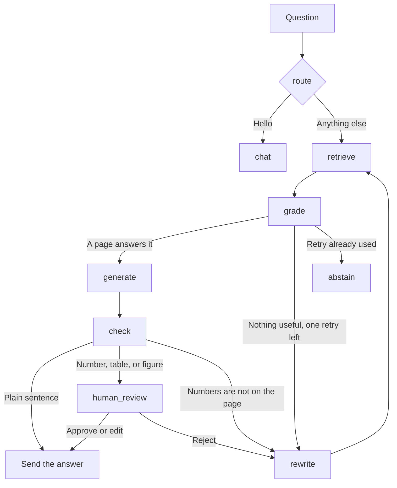

# Agentic Document RAG

Use the **Ledgerline document desk** to ask a question about a PDF or Word file. Follow the search results back to the source page, then check a draft before approving it. Try the PNC example to see why a number can appear on the right page and still come from the wrong column.

## Run it

Start Ollama and make sure `qwen3.5:4b` and `qwen3-embedding:4b` are available. Then run these commands from this folder with your course Python environment active.

```bash
python -m pip install -r requirements.txt
python download_corpus.py
python document_rag.py build
python -m streamlit run app.py
```

The download script puts seven PDFs and one Word file in `corpus/`. The first index build can take several minutes while Qwen reads chart images. Later runs reuse `chroma_db/`. If the sidebar reports that Ollama is down, start it and refresh the app.

## Try the app

Open **Path** under a reply to see the graph steps it took. If the graph pauses on a draft, approve, edit, or reject it before asking another question.

| Button | What to look for |
|---|---|
| Greeting | The path goes directly to `chat`. |
| Not in the packet | The HarborDesk leave question returns `NOT_IN_CORPUS`. |
| Walker Ranch figure | Follow the source to the prose about the red dots and the related figure. |
| PNC table — needs a signature | Open Table 5 on page 7. Check the charge-off amount and the loss rate in their own columns. Edit the draft if it uses the wrong one. |

## Architecture



The check step sends a supported draft to review when it uses a table, figure, or measured number. If a check fails, the graph can try a new search. Approving uses the draft as written. Editing sends the text you enter.

## Follow the code

Pick a question you tried in the app. Start at `START HERE` in `document_rag.py` and look up the steps shown in **Path**.

- `app.py` calls `ask` when you choose a question. It calls `ask` again with `resume` when you review a draft.
- `route` sends greetings to `chat` and other questions to `retrieve`.
- `retrieve` combines keyword and vector search. `grade` checks whether each passage answers the question. `rewrite` can try a new query once.
- `generate` drafts from the passages that passed. `check` verifies that each measured number appears in those passages.
- `human_review` pauses at `interrupt()`. `abstain` handles questions the documents can't answer.
- `build_assistant` connects these steps. The functions above `START HERE` prepare the files and build the index.

## Notebooks

Run these from this folder after `download_corpus.py`. Notebook 2 builds the index, so you can skip `document_rag.py build` if you finish notebook 2 first.

| Notebook | What you'll do |
|---|---|
| [01_parse_real_documents.ipynb](01_parse_real_documents.ipynb) | Find a value the PDF text layer missed, then compare the extracted tables and captions. |
| [02_index_and_retrieve.ipynb](02_index_and_retrieve.ipynb) | Build the index and check whether the right pages appear in the search results. |
| [03_sign_the_draft.ipynb](03_sign_the_draft.ipynb) | Pause the graph, check the PNC source page, and edit a draft. |

The [Advanced Agentic Patterns Guide](advanced_agentic_patterns_guide.ipynb) uses small example tools and can run independently of the document lab with `qwen3.5:4b` in Ollama.

## Files

| File | Role |
|---|---|
| `app.py` | The screen |
| `document_rag.py` | Parse, search, and the graph |
| `download_corpus.py` | Fetch the packet once |
| `caption_overrides.json` | A few figure captions kept by hand |
| `requirements.txt` | Libraries for this demo only |
