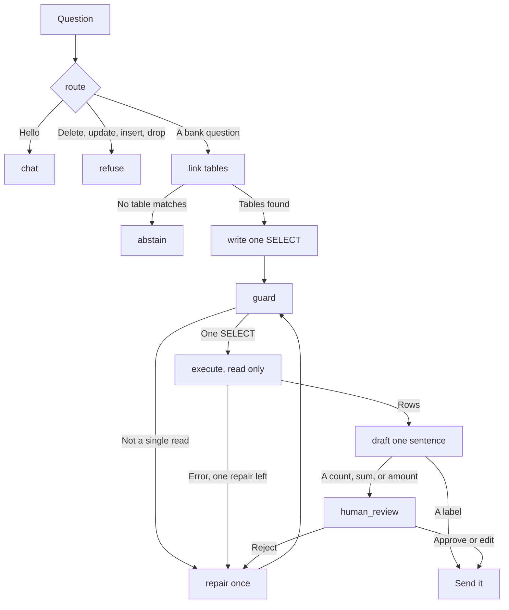

# 02 — Bank book

The same four rules, on a second drawer. The customer asks for a count or a card type. The app links the right tables, writes one `SELECT`, runs it read-only, and waits when the result is a measured number.

The screen title is **Berka branch desk**. The file is a real Czech bank database: 8 tables and about a million transactions. Column `A2` does not say "district name". `semantic_layer.json` is the dictionary that says so.

## Run it

From this folder, with the course Python environment active:

```bash
python -m pip install -r requirements.txt
python download_corpus.py
python -m streamlit run app.py
```

`download_corpus.py` copies `data/financial.sqlite` out of the FINCH dataset. The database is about 71 MB and is not in git. The script also checks the saved questions. If a stored answer changed, it stops.

Ollama must be running, with `qwen3.5:4b`. This demo does not need the embedding model. Eight tables fit in the prompt after a keyword link.

Open **Path** under each answer. When a sentence waits, the SQL and the grid sit beside it. Read the grid before you approve.

## Click these, in order

| Button | What you are checking |
|---|---|
| Greeting | The database stays closed. |
| Not in the bank | HarborDesk leave is not in these tables. The desk says `NOT_IN_DATABASE`. |
| Delete a loan | She refuses before any SQL is written. |
| Card type — no signature | The answer is a word. A word does not wait. |
| Pisek accounts — needs a signature | The answer is a count. A person signs it. |

Fill in the two answers from the screen:

- Client 13539's card type: ________
- Accounts in Pisek: ________

## Architecture



There are two locks on a write. `route` hears the question and refuses "delete". `guard_sql` reads the SQL itself, in case a delete was ever written. The connection is read-only as well. A prompt is not one of these locks.

A card type is a label, so it is sent. A count is a measurement, so a person signs the sentence. Approve and edit do not call the model again.

## Code checklist

Search `text2sql.py` for `START HERE`, then read in this order.

- [ ] `app.py` — the five buttons call `ask`. A signature resumes the same thread.
- [ ] `route` — hello, a write, or a bank question.
- [ ] `refuse` — the model is not asked to draft the `DELETE`.
- [ ] `link_tables` — which tables this question needs. The dictionary is `semantic_layer.json`.
- [ ] `write_sql` — one statement, using the real spellings from the value catalog.
- [ ] `guard_sql` — no SQL, more than one statement, not a read, or it does not start with `SELECT`.
- [ ] `execute_sql` — read-only connection, a row cap, and a time cap.
- [ ] `repair` — one new `SELECT`, then the guard again.
- [ ] `draft` — one sentence from the grid. A number that is not in the grid is replaced.
- [ ] `human_review` — pause until the person approves, edits, or rejects.
- [ ] `build_assistant` — the wires in the picture above.

## Notebooks, same story, slower

Run these from this folder after `download_corpus.py`. Notebook 1 does not need Ollama. Notebooks 2 and 3 do.

| Notebook | What one pass teaches |
|---|---|
| `01_the_bank_database.ipynb` | Open the file. Read the dictionary next to names like `A2`. A lowercase filter misses the stored spelling. |
| `02_link_guard_execute.ipynb` | Link the tables, refuse a write, run one `SELECT`. |
| `03_sign_the_number.ipynb` | The same graph as the app. A count pauses for a person. |

## Files

| File | Role |
|---|---|
| `app.py` | The screen |
| `text2sql.py` | Link, guard, execute, and the graph |
| `semantic_layer.json` | What each cryptic column means |
| `questions.json` | The checked questions and their result grids |
| `download_corpus.py` | Fetch the SQLite file once and check those grids |
| `requirements.txt` | Libraries for this demo only |
