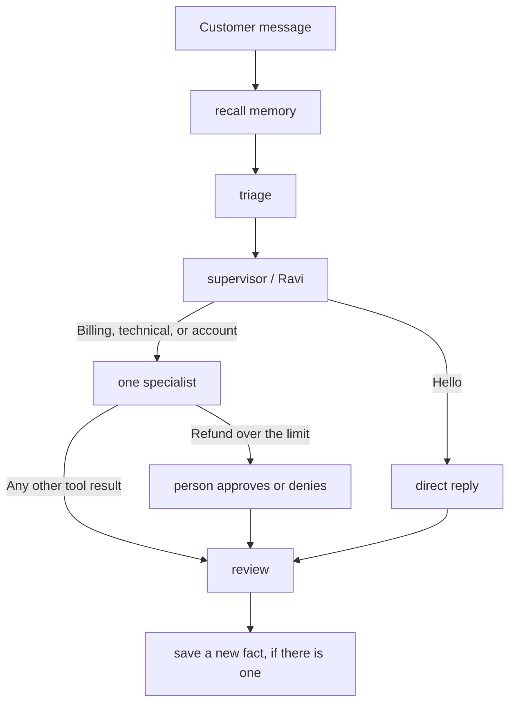

# 03 — Nova support

This is the first demo with more than one job in one shop. **Ravi** reads the message and points at one desk. The specialist answers. Their tools do not mix.

The company is CloudNova, a small project tool. The customers are fictional and live in `data/customers.json`.

| Customer | Why this person is useful |
|---|---|
| Priya Sharma | Pro plan, $75 a month, a paid $30 invoice |
| Marcus Lee | Business plan, a failed $400 charge |

Stay with Priya for the first four messages. Switch customers from the sidebar. Each customer has a separate conversation.

## Run it

From this folder, with the course Python environment active:

```bash
python -m pip install -r requirements.txt
python -m streamlit run app.py
```

Nothing to download. Ollama must be running, with `qwen3.5:4b` and `qwen3-embedding:0.6b`. The sidebar turns green when the chat model is ready. The first reply can take a little while.

The left column is the chat. The right column is **Agent Activity**. Read that column. It is the graph, one node at a time.

## Type these, in order

| You type, as Priya | What you should see on the right |
|---|---|
| Good morning | Direct reply. No specialist, no tool. |
| What plan am I on? | Supervisor points at billing. Billing calls the plan tool. |
| My board is not syncing | Supervisor points at technical. Technical searches the help center before it answers. |
| Please refund my last charge of $30 | Billing asks. The amount is within the limit in `config.py`, so the program approves it. |
| Please refund $400 | The graph pauses. Approve or deny on the card. Then the reply continues. |

A refund tool does not move money. It only records the request. `core/graph.py` compares the amount with `REFUND_AUTO_APPROVE_LIMIT`. That line is the rule. The model cannot edit it.

## Architecture



Ravi points. He does not answer, and he does not hold the specialists' tools.

| Specialist | Tools she is given |
|---|---|
| Billing | plan, invoices, refund request, change plan |
| Technical | search the help center, open a ticket, service status |
| Account | password reset, seats, two-factor |

Billing cannot search the help center, because that tool was never given to her.

Review runs when the customer is angry or the priority is high. A routine reply skips that extra pass. Memory runs last, so a later chat can remember a durable fact.

## Code checklist

Search `core/graph.py` for `START HERE`. The picture above is that function.

- [ ] `config.py` — model names, and the refund limit. One place for the money rule.
- [ ] `app.py` — `bootstrap` builds the graph once. `graph.stream` paints the right-hand panel as each node finishes. An interrupt becomes the Approve / Deny card.
- [ ] `core/graph.py` — `build_graph`. Read the edges at the bottom. They are the arrows.
- [ ] `recall_memory` — facts saved from earlier chats.
- [ ] `triage_node` — category, priority, sentiment.
- [ ] `supervise_node` — one word: billing, technical, account, or direct.
- [ ] `handle_node` — runs one specialist. Applies the refund rule here, not inside the tool.
- [ ] `approval_node` — `interrupt()` pauses until the person clicks.
- [ ] `core/agents.py` — `triage`, `supervise`, `run_specialist`, `review`, `extract_facts`.
- [ ] `run_specialist` — a short loop: the model may call a tool, read the result, then answer. The loop stops after `MAX_TOOL_STEPS`.
- [ ] `core/tools.py` — each tool takes an amount or a query, never a customer id. The graph sets the customer.

`ui/` is how the page looks. Read it after the graph is clear.

`core/schemas.py` is the strict shape you would use with a stronger model. This demo parses a short line of text instead, so the local model stays fast. The functions in `agents.py` say why.

## Files

```
app.py                 the screen and the live stream
config.py              model names and the refund limit
core/graph.py          the flowchart
core/agents.py         triage, Ravi, specialists, review, memory
core/tools.py          what each desk is allowed to call
core/backend.py        the fictional customers and their invoices
core/knowledge_base.py help-center search for the technical desk
core/memory.py         facts that survive a new conversation
core/llm.py            the Ollama client
data/customers.json    Priya, Marcus, and Aisha
data/knowledge_base.md the help articles
```
