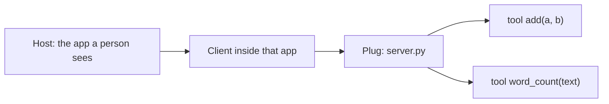

# 04 — The plug

The tools in the first three demos live inside one Streamlit app. If Slack also needs the bank book, someone will copy that door into Slack. Then there are two doors.

MCP is a standard socket so both apps call one program. People call that program a server. In this folder it is `server.py`. It publishes two tiny tools, `add` and `word_count`, so you can see the shape. A real plug would publish `search_the_packet` and `run_this_select`.

The plug does not answer the customer. It does not make the model smarter. It runs a named job and returns the result.

## Read it

Open `server.py` and read it top to bottom. The whole lesson is in that file.

```bash
# You do not need to start it.
# If you do, it waits on standard input for a host app. It is not a website.
python -m pip install -r requirements.txt
python server.py
```

Stop it with Ctrl+C.

## Architecture



| Word | In this folder |
|---|---|
| Host | Streamlit, Slack, Cursor. The host decides what may run. |
| Client | The speaker inside the host. The person never sees it. |
| Server | `server.py`. A small program that publishes tools. |
| Tool | A job with a name and typed arguments. `add` wants two integers. |
| Resource | Something to read, such as a PDF. This file does not publish one. |
| Prompt | A saved instruction. This file does not publish one. |

One call looks like this:

```
App asks: what tools do you have?
Plug says: add(a: int, b: int), word_count(text: str)
App calls: add(2, 3)
Plug returns: 5
```

The model may choose the tool. The plug runs it. The host still owns the rules from the earlier demos: no delete, and a measured number waits for a person. Moving the tool into a plug does not remove those rules.

## Code checklist

- [ ] `FastMCP("demo")` — the name of the plug.
- [ ] `@mcp.tool()` on `add` — publish a function. The type hints are the arguments a host can see.
- [ ] `@mcp.tool()` on `word_count` — a second tool on the same plug.
- [ ] `mcp.run()` — speak over standard input and output. On another machine the cable would be HTTP. The tools stay the same.

## When to build one

Build a plug when a second app needs the same tool. One Streamlit desk does not need a plug yet. The paper drawer and the bank book are still just functions inside their own apps.
