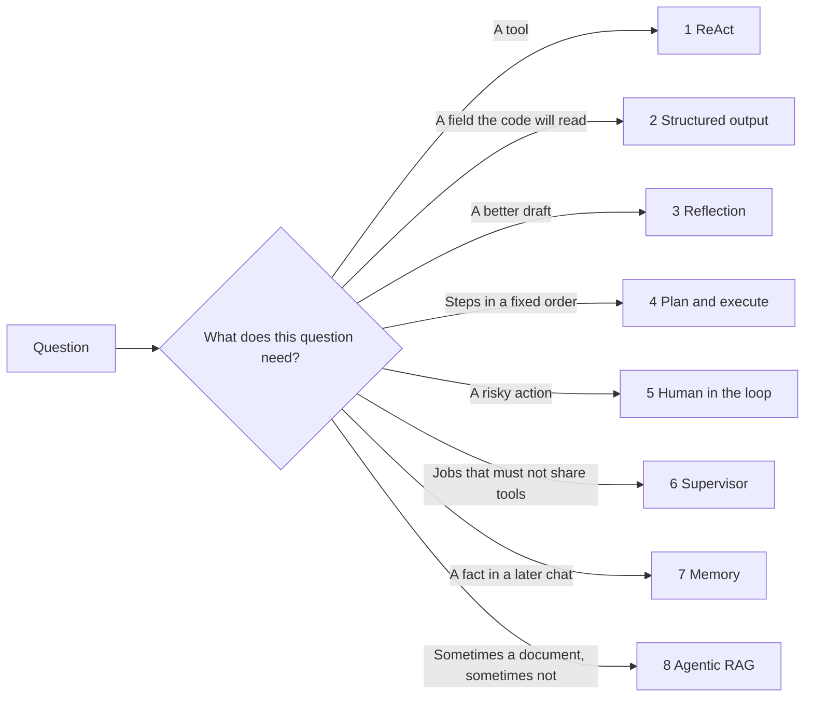

# 05 — Eight small patterns

Optional. Do this after the four demos, when you want each idea on its own, with toy tools.

The notebook does not use the PDFs or the bank file. Each pattern is a few cells: a short explanation, then a graph you can run.

## Run it

Ollama must be running, with `qwen3.5:4b`.

Open `01_eight_patterns.ipynb` from this folder and run the cells from the top. The first cells check the model. After that, run one pattern at a time.

If a pattern pauses for a person, run the pause cell, then the resume cell. Change `human_decision` in that cell to take the other branch.

## The eight patterns

| # | Pattern | Where you already saw it |
|---|---|---|
| 1 | ReAct. Reason, call a tool, read the result, repeat. | Nova's specialist loop |
| 2 | Structured output. Fill fields instead of writing a paragraph. | The grade and the check on the document desk |
| 3 | Reflection. Draft, then critique. | Nova's review node, only when the customer is unhappy |
| 4 | Plan, then do each step. | The bank path is fixed: link, guard, execute. That is a plan written by us, not by the model. |
| 5 | Pause before a risky action. | A signed number, and a large refund |
| 6 | A supervisor picks one specialist. | Ravi |
| 7 | A fact that survives a new chat. | Nova's memory store |
| 8 | Decide whether a search is needed. | "Good morning" leaves the drawer shut |

## Code checklist

The notebook is the script. For each pattern:

- [ ] Read the markdown cell. It says what the pattern is and when it earns its place.
- [ ] Run the code cell under it.
- [ ] Find the `StateGraph`. The nodes and the edges are the whole example.
- [ ] Read the one-line comment above the graph before you read the prompt.

Pattern 6 is the smallest picture of Ravi: one router, two specialists, tools that do not cross. Pattern 5 is the smallest picture of a signature.
