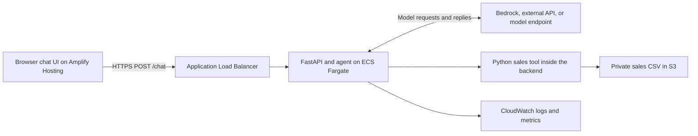

# 07. How the sales API could run on AWS

This is a deployment design for the [sales API](04_sales_agent_api.md). Follow one request from the browser to the backend, model, and sales tool. The local lab runs with sample data on your computer.

## 1. Put each piece in the right place

| Part | Where it runs | What it does |
|---|---|---|
| Chat UI | React on **AWS Amplify Hosting** | Shows the chat box, sends questions to the backend, and displays replies. Connect the UI's Git branch and set its public API URL. |
| Backend API | **FastAPI on Amazon ECS with AWS Fargate** | Serves `POST /chat` and a health endpoint. Validates the user, runs the LangChain or LangGraph agent, and sets limits on the run. |
| Public entry point | **Application Load Balancer** | Receives HTTPS traffic and routes it to healthy backend containers in private subnets. Use an ACM certificate for the API domain. |
| Tool | A Python function packaged with the backend | `sales_by_region(month)` reads the report and calculates totals. Ship it in the same Docker image for this example. |
| Model | **Amazon Bedrock**, a model provider's API, or a model endpoint you deploy | Reads the question, requests a tool call when needed, and writes a reply from the returned data. |
| Data | **Amazon S3** for the report | Keep the CSV private. Give the backend's ECS task role permission to read the report. Use a database such as DynamoDB or RDS if the app later needs durable chat or workflow state. |

[Amplify Hosting](https://docs.aws.amazon.com/amplify/latest/userguide/getting-started.html) · [ECS load balancing](https://docs.aws.amazon.com/AmazonECS/latest/developerguide/service-load-balancing.html) · [ECS task roles](https://docs.aws.amazon.com/AmazonECS/latest/developerguide/task-iam-roles.html)

**Follow one request.** The UI sends `POST /chat` with Priya's question. The backend validates her access and sends the question and tool description to the model. The model requests `sales_by_region(month="March")`. The backend checks the arguments and runs the tool. Python adds the rows and returns `North: 1200`, `South: 900`, `East: 600`. The backend passes the result back to the model and returns its reply to the UI.

The backend runs the sales tool with its AWS permissions. The model receives the totals to use in its reply. [Amazon Bedrock tool use](https://docs.aws.amazon.com/bedrock/latest/userguide/tool-use.html)

## 2. Decide where the tools and APIs run

Start with the sales tool in the backend. Give a tool its own deployment when another app needs it, a different team owns it, or it needs different permissions or scaling.

| Tool situation | How to deploy or connect it |
|---|---|
| Small calculation or lookup used by one agent | Keep it as a Python function in the backend container. It can read S3 using the backend task role. |
| Short tool with its own permissions | Deploy the handler to **AWS Lambda**. The backend invokes it through the AWS SDK. The backend role gets permission to invoke that function, and the Lambda execution role gets permission to access its data. |
| Shared internal business API | Run the API as a separate **ECS service** behind an internal load balancer. The agent backend calls it over the private network using service credentials. |
| Existing external API | Keep it where it is. Write a small backend tool that calls it over HTTPS. Store any API key in **AWS Secrets Manager** and set a timeout. |

The browser calls the app API. If you need a dedicated API front door, you can put **Amazon API Gateway** in front of the backend. An HTTP API can validate Cognito access tokens with a JWT authorizer and reach an internal load balancer through a VPC link. For the layout above, the browser sends the access token to FastAPI through the load balancer, and FastAPI validates it and checks the user's access. If the UI and API use different domains, configure CORS for the UI's origin.

[API Gateway JWT authorizers](https://docs.aws.amazon.com/apigateway/latest/developerguide/http-api-jwt-authorizer.html) · [Private API integrations](https://docs.aws.amazon.com/apigateway/latest/developerguide/http-api-develop-integrations-private.html)

## 3. Choose how to serve the LLM

| Model setup | What you deploy | How the backend calls it |
|---|---|---|
| **Managed model on Bedrock**, including supported closed or open-weight models | Deploy the app and select a model available in your AWS Region. AWS hosts the model. Check that it supports tool calling. | Call the Bedrock runtime through the AWS SDK, for example with `Converse`. Give the backend task role model invocation permissions. |
| **Closed model from an external provider** | Deploy the app on AWS and use the provider's hosted model. | Call the provider's HTTPS API from the backend. Keep credentials in Secrets Manager and give private ECS tasks a path for outbound internet traffic, such as a NAT gateway. |
| **Open-weight model on SageMaker AI** | Choose a supported model and serving container, for example a suitable JumpStart option. Deploy a real-time endpoint on an instance sized for the model. | Invoke the endpoint with the AWS SDK and the backend task role. Test whether your chosen serving stack supports the chat and tool-call format your agent uses. |
| **Open-weight model on EC2 GPUs** | Run a model server such as **vLLM** on a GPU instance in a private subnet. Your team manages the server, GPU capacity, updates, and scaling. | Call its private inference endpoint from the backend. Check the model's chat template and tool-call parser with an actual tool call. |

An open-weight model can run on a managed endpoint or on infrastructure you manage, subject to its license. The FastAPI container can stay on Fargate while the model runs on a separate GPU endpoint.

[Bedrock model compatibility](https://docs.aws.amazon.com/bedrock/latest/userguide/models.html) · [Bedrock inference permissions](https://docs.aws.amazon.com/bedrock/latest/userguide/inference-prereq.html) · [SageMaker AI real-time endpoints](https://docs.aws.amazon.com/sagemaker/latest/dg/realtime-endpoints.html) · [vLLM tool calling](https://docs.vllm.ai/en/latest/features/tool_calling/)

## 4. Deploy in this order

1. **Turn the notebook into an API.** Move the agent and tool into Python modules. Add `POST /chat` and `GET /health`. Test locally with the four cases from Lesson 02, then build a Docker image.
2. **Set up the data and model.** Upload the report to a private S3 bucket. Select a managed model or deploy an endpoint. Confirm that the backend can read the report and complete one real tool call.
3. **Ship the backend.** Push a versioned image to **Amazon ECR** and deploy it as an **ECS Fargate** service. Configure the load balancer to check `/health`. Give the task network access to the AWS services it uses through VPC endpoints or appropriate outbound routing. The **task role** is for calls made by your code. The **task execution role** lets ECS do jobs such as pulling the image, sending container logs, and fetching secrets configured in the task definition. [Fargate networking](https://docs.aws.amazon.com/AmazonECS/latest/developerguide/fargate-task-networking.html) · [Task execution role](https://docs.aws.amazon.com/AmazonECS/latest/developerguide/task_execution_IAM_role.html)
4. **Ship the UI.** Deploy the React build with Amplify Hosting and set the API's HTTPS URL. Add sign-in, for example with Cognito, and verify that signed-in users can call the API and unauthorized requests are rejected. Keep provider credentials in the backend.
5. **Test the deployed system in staging.** Run the same evals for a March winner, a missing month, no April data, and a tie. Check both the reply and the tool trace. Then test what the UI shows if the model or tool times out. Keep the previous image and model or prompt settings so you can roll back a bad release. [ECS deployment failure detection and rollback](https://docs.aws.amazon.com/AmazonECS/latest/developerguide/deployment-failure-detection.html)

## 5. What to watch after release

- **Trace a request.** Give each request an ID. Log the tool name, outcome, and elapsed time so you can tell whether the delay came from the backend, tool, or model. Keep secrets and raw customer data out of logs.
- **Watch the slow and expensive parts.** Use CloudWatch to monitor API errors and latency. Track model tokens for managed APIs and GPU usage for models you host. Set timeouts and cap how many tool calls one request can make. [ECS CloudWatch monitoring](https://docs.aws.amazon.com/AmazonECS/latest/developerguide/cloudwatch-metrics.html)
- **Move long jobs to a worker.** For a task that takes longer than a chat request can wait, return a job ID. Queue the work in SQS, let a worker run the agent, and have the UI fetch the status and result.

**Try it on paper.** Switch the model in the diagram from Bedrock to a model server on EC2. Mark where the backend's model call changes. List three evals to run before making that switch.
