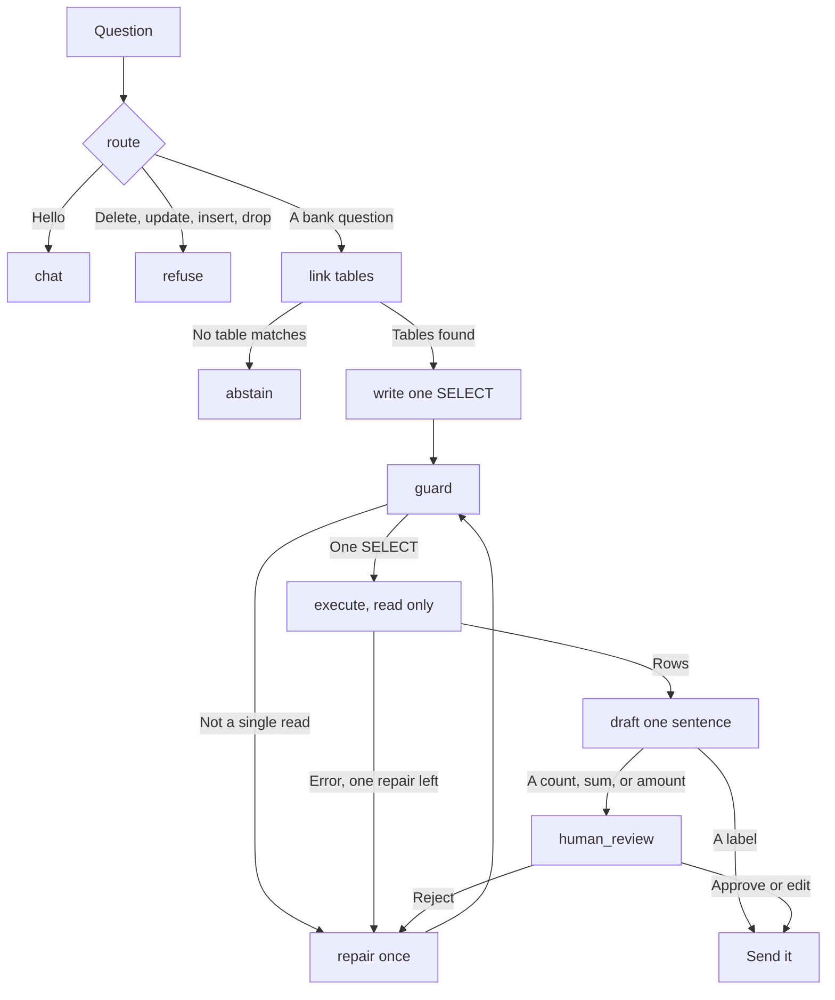

# Agentic Text-to-SQL

Use the **Berka branch desk** to ask a question about a Czech bank database. Follow the steps from your question to the SQL and its result. For “How many accounts are in Pisek?”, the agent needs to know that `A2` means district name. That description comes from `semantic_layer.json`.

## Run it

Start Ollama with `qwen3.5:4b` available. Then run these commands from this folder with your course Python environment active.

```bash
python -m pip install -r requirements.txt
python download_corpus.py
python -m streamlit run app.py
```

`download_corpus.py` fetches `data/financial.sqlite` from FINCH and checks the saved query results. The download is about 71 MB. The lab uses keyword matching to select from the eight tables.

## Try the app

Open **Path** after each question. When the graph pauses, you can read the SQL and result grid beside the draft.

| Button | What you are checking |
|---|---|
| Greeting | The graph answers directly. |
| Not in the bank | The HarborDesk leave question returns `NOT_IN_DATABASE`. |
| Delete a loan | The graph refuses the request before generating SQL. |
| Card type — no signature | The app returns the card type directly. |
| Pisek accounts — needs a signature | The app waits for you to check the count and its district filter. |

Record the card type for client `13539` and the number of accounts in Pisek. For the count, check which tables the model joined and which district spelling it used.

## Architecture



The app checks for a write request in `route`, checks the generated statement in `guard_sql`, and opens SQLite in read-only mode. Counts and other numeric results pause for review. Approving uses the current draft. Editing sends the text you enter.

## Follow the code

Open `text2sql.py` at `START HERE` and follow the steps you saw for the Pisek question.

- `app.py` calls `ask`. A review decision resumes the same thread.
- `route` separates greetings, write requests, and bank questions. `refuse` handles write requests.
- `link_tables` uses the column descriptions to choose tables. `write_sql` uses the stored spellings in the value catalog to write a query.
- `guard_sql` checks that the model returned a single read query. `execute_sql` runs it with row and time limits. `repair` lets the graph try another query once.
- `draft` writes a sentence from the grid. `human_review` pauses for your decision. `build_assistant` connects the steps.

## Notebooks

Run these from this folder after `download_corpus.py`. Notebook 1 does not need Ollama. Notebooks 2 and 3 do.

| Notebook | What you'll do |
|---|---|
| [01_the_bank_database.ipynb](01_the_bank_database.ipynb) | Explore the tables and check how case and date formats affect a count. |
| [02_link_guard_execute.ipynb](02_link_guard_execute.ipynb) | Choose tables, test the SQL guard, and compare results with the saved answers. |
| [03_sign_the_number.ipynb](03_sign_the_number.ipynb) | Check the query and result for Pisek, then edit the draft answer. |

The human approval lab is also available at its original filename, [03_agentic_text2sql_hitl.ipynb](03_agentic_text2sql_hitl.ipynb).

## Files

| File | Role |
|---|---|
| `app.py` | The screen |
| `text2sql.py` | Link, guard, execute, and the graph |
| `semantic_layer.json` | What each cryptic column means |
| `questions.json` | The checked questions and their result grids |
| `download_corpus.py` | Fetch the SQLite file once and check those grids |
| `requirements.txt` | Libraries for this demo only |
